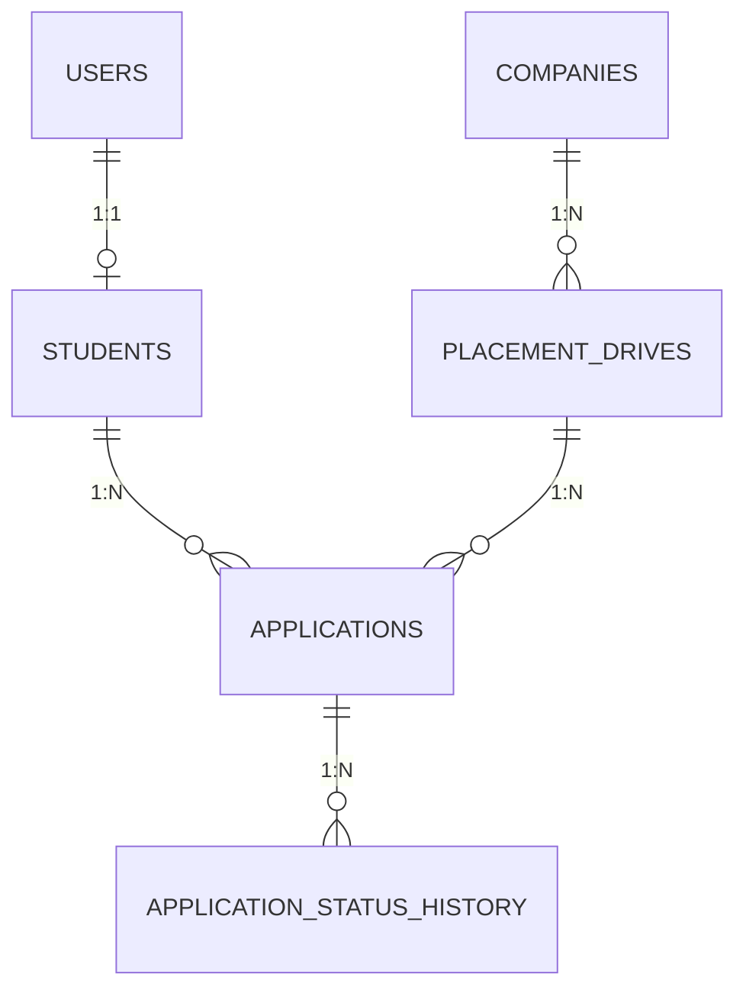

# Placement Tracker
### Smart Campus Placement Management System — ABESEC Ghaziabad

A full-stack, SaaS-style campus placement management portal built with **Spring Boot 3 (Java 21)**, **MySQL 8**, and **React + Vite + Tailwind CSS**.

---

## Project Overview

**Placement Tracker** centralizes campus recruitment operations for **ABESEC Ghaziabad**, connecting students and the Training & Placement Cell through role-based dashboards, automated eligibility evaluation, database-backed PDF resume management, and real-time analytics.

### Problem Statement
Traditional campus placement workflows rely on scattered spreadsheets, manual eligibility checks, email threads for status updates, and static reports—causing missed deadlines, duplicate or ineligible applications, and poor visibility into placement metrics.

### Objectives
- Provide a unified portal for Student Profile Management, Company Onboarding, Drive Publishing, and Application Tracking.
- Enforce automated academic eligibility rules (CGPA, active backlogs, branch, passing year, and deadlines).
- Prevent duplicate applications at both the application layer and database constraint level.
- Deliver live branch-wise, company-wise, and monthly placement analytics to administrators.
- Ensure stateless JWT security with BCrypt password hashing and production-ready cloud deployment.

---

## Key Features

### Public Portal
- **Landing Page**: Hero overview, live placement statistics from backend APIs, platform capabilities, workflow guide, and featured drives.
- **About Page**: Project objectives and benefits for students and administrators.
- **Authentication**: Role-based login (Admin & Student) and public Student Registration (`STUDENT` role only).

### Admin Dashboard
- **Overview & Analytics**: Live KPIs (Total Students, Companies, Active Drives, Applications, Placed Students, Placement %, Average & Highest Package) and Recharts visualizations (Branch-wise placements, Company-wise applications, Monthly trends, Selection funnel).
- **Student Management**: Search by name/enrollment/email, filter by branch and passing year, add/edit/deactivate/delete students, inspect eligibility & resumes.
- **Company Management**: Add, edit, search, and delete recruiting partners with HR contact details.
- **Placement Drive Management**: Create, edit, publish/unpublish, and delete drives; view applicants per drive.
- **Application Management**: Filter by company, drive, branch, and status; update statuses (`APPLIED`, `UNDER_REVIEW`, `SHORTLISTED`, `INTERVIEW_SCHEDULED`, `SELECTED`, `REJECTED`) with remarks and full audit history.

### Student Dashboard
- **Overview**: Personalized welcome banner, profile completion meter, eligible vs available drives, and recent applications.
- **Profile & Resume**: Manage academic info (CGPA, backlogs, skills, LinkedIn/GitHub/Portfolio) and upload PDF resumes stored securely in MySQL (`LONGBLOB`/`MEDIUMBLOB`)—compatible with ephemeral cloud containers like Render.
- **Placement Drives & Eligibility**: Search/filter drives by company, package, branch, job type, and deadline; automatic eligibility check with detailed reasons.
- **Application Tracking**: Real-time application list with complete status history timeline.

---

## Technology Stack

| Layer | Technologies |
| --- | --- |
| **Frontend** | React 18, Vite, JavaScript, Tailwind CSS, React Router DOM, Axios, Lucide React, Recharts, React Hot Toast |
| **Backend** | Java 21 LTS, Spring Boot 3.5, Spring Security, Spring Data JPA, Hibernate, Spring Validation, JJWT 0.12.6, Maven |
| **Database** | MySQL 8 (H2 in-memory MySQL mode for automated tests) |
| **Deployment** | GitHub, Render (Docker Web Service + Static Site), External Managed MySQL (e.g., Aiven / Railway / TiDB / PlanetScale-compatible MySQL 8) |

---

## Screenshots

> _Placeholders: Add live screenshots after deploying to Render._

- `[Landing Page Screenshot Placeholder]`
- `[Admin Analytics Dashboard Screenshot Placeholder]`
- `[Student Placement Drives & Eligibility Screenshot Placeholder]`
- `[Application Status Timeline Screenshot Placeholder]`

---

## Project Architecture

```text
placementTracker/
├── backend/
│   ├── Dockerfile
│   ├── pom.xml
│   └── src/main/java/com/placementtracker/
│       ├── PlacementTrackerApplication.java
│       ├── config/          # SecurityConfig, CorsConfig, DataInitializer
│       ├── controller/      # Auth, Student, Admin, Company, Drive, Application, Dashboard, Health
│       ├── dto/             # Request & Response records
│       ├── entity/          # User, Student, Company, PlacementDrive, Application, ApplicationStatusHistory
│       ├── exception/       # Custom exceptions + GlobalExceptionHandler
│       ├── mapper/          # EntityMapper
│       ├── repository/      # Spring Data JPA repositories
│       ├── security/        # JwtService, JwtAuthenticationFilter, CustomUserDetailsService
│       ├── service/         # Business logic & EligibilityService
│       └── util/            # Constants
├── frontend/
│   ├── public/_redirects    # SPA routing fallback
│   └── src/
│       ├── config/          # siteConfig.js (ABESEC header/footer & team config)
│       ├── context/         # AuthContext
│       ├── components/      # Reusable UI + DashboardLayout + PublicNavbar + Footer
│       ├── pages/           # public/, auth/, admin/, student/
│       ├── routes/          # ProtectedRoute
│       └── services/        # Axios API client & domain services
└── render.yaml              # Render Blueprint (API Docker + Static Site)
```

---

## Database Design



- **Unique Constraints**:
  - `users.email`, `users.username`
  - `students.user_id`, `students.enrollment_number`
  - `companies.name`
  - `applications(student_id, drive_id)` (`uk_application_student_drive`) — database-level duplicate application prevention.

---

## Local Setup & Installation

### Prerequisites
- Java 21+
- Maven 3.9+
- Node.js 20+ & npm
- MySQL 8+

### 1. Backend Setup
```bash
cd backend
cp .env.example .env
# Edit .env with your local MySQL credentials and JWT secret
mvn spring-boot:run
```
Backend runs on `http://localhost:8080`. Health check: `GET http://localhost:8080/api/health`.

Run backend JUnit & Mockito tests:
```bash
cd backend
mvn test
```

### 2. Frontend Setup
```bash
cd frontend
cp .env.example .env
npm install
npm run dev
```
Frontend runs on `http://localhost:5173`.

---

## Environment Variables

### Backend (`backend/.env.example`)
| Variable | Description | Default / Example |
| --- | --- | --- |
| `SPRING_PROFILES_ACTIVE` | Active Spring profile (`dev` or `prod`) | `dev` |
| `PORT` | Server port | `8080` |
| `DATABASE_URL` | JDBC MySQL 8 connection string | `jdbc:mysql://localhost:3306/placement_tracker?...` |
| `DATABASE_USERNAME` | MySQL username | `root` |
| `DATABASE_PASSWORD` | MySQL password | — |
| `JWT_SECRET` | Base64-encoded 256-bit secret key | — |
| `JWT_EXPIRATION_MS` | Token expiry in milliseconds | `86400000` |
| `CORS_ALLOWED_ORIGINS` | Comma-separated allowed frontend origins | `http://localhost:5173` |
| `ADMIN_USERNAME` | Seeded admin username | `admin` |
| `ADMIN_EMAIL` | Seeded admin email | `admin@abesec.ac.in` |
| `ADMIN_PASSWORD` | Seeded admin password | `Admin@123` |
| `DEMO_STUDENT_USERNAME` | Seeded demo student username | `2026cs001` |
| `DEMO_STUDENT_EMAIL` | Seeded demo student email | `aarav.sharma@abesec.ac.in` |
| `DEMO_STUDENT_PASSWORD` | Seeded demo student password | `Student@123` |

### Frontend (`frontend/.env.example`)
| Variable | Description | Example |
| --- | --- | --- |
| `VITE_API_BASE_URL` | Base URL of deployed Spring Boot API (no trailing slash) | `https://placement-tracker-api.onrender.com` |

---

## API Documentation

| Method | Endpoint | Access | Description |
| --- | --- | --- | --- |
| `GET` | `/api/health` | Public | Backend health check |
| `GET` | `/api/public/overview` | Public | Public placement metrics & featured drives |
| `POST` | `/api/auth/login` | Public | Login with email/username/enrollment & password |
| `POST` | `/api/auth/register` | Public | Student self-registration (`STUDENT` role only) |
| `POST` | `/api/auth/logout` | Authenticated | Revoke current JWT token |
| `GET` | `/api/auth/me` | Authenticated | Current user session details |
| `GET` | `/api/dashboard/admin` | `ADMIN` | Admin KPIs and Recharts analytics datasets |
| `GET` | `/api/dashboard/student` | `STUDENT` | Student KPIs, completion %, recent drives & applications |
| `GET/PUT` | `/api/student/profile` | `STUDENT` | Get or update own profile |
| `POST` | `/api/student/resume` | `STUDENT` | Upload PDF resume (max 5MB, stored in DB) |
| `GET` | `/api/students/{id}/resume` | Owner / `ADMIN` | Download/view uploaded PDF resume |
| `GET/POST/PUT/DELETE` | `/api/admin/students/**` | `ADMIN` | Manage student accounts & eligibility |
| `GET/POST/PUT/DELETE` | `/api/companies/**` | Authenticated (`GET`), `ADMIN` (write) | Manage recruiting companies |
| `GET/POST/PUT/PATCH/DELETE` | `/api/drives/**` | Authenticated (`GET`), `ADMIN` (write) | Manage placement drives & publishing |
| `POST` | `/api/applications` | `STUDENT` | Apply to an eligible open drive |
| `GET` | `/api/applications/my` | `STUDENT` | View own applications & status history |
| `GET` | `/api/applications` | `ADMIN` | Search & filter all applications |
| `PUT` | `/api/applications/{id}/status` | `ADMIN` | Update application status & append history |

---

## Demo Credentials

> Default seeded demo credentials (override in production via environment variables):

- **Admin Account**
  - **Username / Email**: `admin` / `admin@abesec.ac.in`
  - **Password**: `Admin@123`
- **Student Account**
  - **Username / Email**: `2026cs001` / `aarav.sharma@abesec.ac.in`
  - **Password**: `Student@123`

---

## Deployment Links

- **GitHub Repository**: [https://github.com/AmandeepO29/FSD_CSE_11](https://github.com/AmandeepO29/FSD_CSE_11) (`placement-tracker/` directory)
- **Live Frontend (Render Static Site)**: `[Render Frontend URL Placeholder]`
- **Live Backend (Render Web Service)**: `[Render Backend URL Placeholder]`

---

## Team Information

Developed & Maintained By:
- **Amandeep**
- **Branch: CSE | Section: 11**
- **Full Stack Development Team — ABESEC Ghaziabad**

© 2026 ABESEC Ghaziabad. All Rights Reserved.
