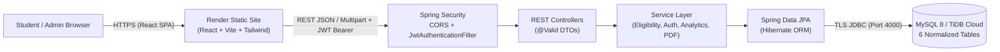
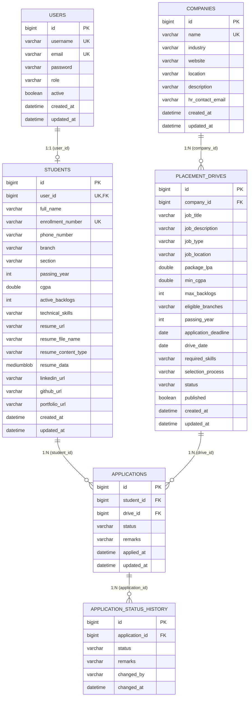

# ABES Engineering College (College Code - 032)
# FSD PROJECT — System Design Document

**Project Title:** Placement Tracker — Smart Campus Placement Management System  
**Institution:** ABESEC Ghaziabad (ABES Engineering College)  
**Developed & Maintained By:** Amandeep (Branch: CSE | Section: 11)  
**Live Application:** https://placement-tracker-web-kk4b.onrender.com  
**Backend API:** https://placement-tracker-api-mrbo.onrender.com  
**GitHub Repository:** https://github.com/AmandeepO29/FSD_CSE_11  

---

## 1. Project Overview

### 1.1 Executive Summary
**Placement Tracker** is an end-to-end, full-stack campus recruitment and placement management platform engineered specifically for **ABESEC Ghaziabad**. Built on a modern layered architecture combining **React, Vite, and Tailwind CSS** on the frontend with **Java 21 LTS, Spring Boot 3.5, Spring Security (JWT), Spring Data JPA, and MySQL 8 (TiDB Cloud)** on the backend, the system digitizes and automates the complete campus placement lifecycle—from student onboarding and resume management to company drive publishing, automated eligibility verification, application stage tracking, and real-time placement analytics.

Traditionally, college Training & Placement (T&P) cells rely on manual Google Forms, disconnected Excel spreadsheets, broadcast emails, and ad-hoc messaging groups to announce campus drives, verify student CGPA/backlog cutoffs, collect resumes, and notify shortlisted candidates. This manual workflow introduces human error, allows ineligible or duplicate applications, obscures real-time placement metrics, and creates unnecessary delays for both students and placement coordinators.

**Placement Tracker** replaces this fragmented process with a unified, database-driven, role-based SaaS portal. Every eligibility rule, application submission, and status transition is enforced deterministically on the server and persisted in a normalized relational database, ensuring auditability, accuracy, and transparency across the campus placement season.

### 1.2 Problem Statement
Campus placement operations at engineering institutions handle hundreds of graduating students across multiple branches (`CSE`, `CSE-AIML`, `CSE-DS`, `IT`, `ECE`, `EEE`, `ME`, `CE`), dozens of recruiting organizations, and multi-round hiring pipelines. Manual coordination faces five core challenges:
1. **Inaccurate Eligibility Filtering**: Checking minimum CGPA, maximum active backlogs, eligible branches, passing year, and deadlines manually across spreadsheets is error-prone.
2. **Duplicate & Invalid Applications**: Without database-level constraints, students can submit multiple entries for the same drive or apply after deadlines.
3. **Lack of Transparency & Audit Trail**: Students often have no centralized place to view why they are ineligible for a drive or track the stage-by-stage history of their applications.
4. **Ephemeral Resume Handling**: Collecting PDF resumes across email attachments or local folders breaks down in cloud environments and makes recruiter/admin access cumbersome.
5. **Delayed Analytics**: Computing branch-wise placement percentages, company-wise conversion funnels, average packages, and highest packages manually slows down institutional reporting.

### 1.3 Objectives
- **Centralize Campus Recruitment**: Provide a single source of truth for student records, partner companies, placement drives, and candidate applications.
- **Automate Academic Eligibility**: Evaluate student CGPA, active backlogs, branch, passing year, drive status, and deadlines in real time before allowing applications.
- **Enforce Data Integrity**: Prevent duplicate applications at both the service layer and MySQL constraint level (`uk_application_student_drive`), and record every status change in an audit history table.
- **Deliver Actionable Analytics**: Provide placement administrators with live KPIs and interactive Recharts visualizations backed directly by MySQL queries.
- **Ensure Production Readiness & Security**: Implement stateless JWT authentication, BCrypt password hashing, strict role-based authorization (`ADMIN` and `STUDENT`), database-backed PDF resume storage (`MEDIUMBLOB`), Docker containerization, and cloud deployment on Render.

### 1.4 Target Audience
The platform is designed for two primary active user personas and two institutional stakeholder groups at **ABESEC Ghaziabad**:

1. **Students (`STUDENT` Role — Primary Users)**
   - Final-year and pre-final-year engineering students across `CSE`, `CSE-AIML`, `CSE-DS`, `IT`, `ECE`, `EEE`, `ME`, and `CE`.
   - **Needs**: Register securely with college email and enrollment number; maintain verified academic profiles (CGPA, backlogs, skills, LinkedIn/GitHub/Portfolio); upload PDF resumes; view open drives with instant eligibility feedback; apply in one click; and track application status timelines (`APPLIED` → `UNDER_REVIEW` → `SHORTLISTED` → `INTERVIEW_SCHEDULED` → `SELECTED` / `REJECTED`).

2. **Training & Placement Cell / Administrators (`ADMIN` Role — Primary Operators)**
   - Placement officers, T&P coordinators, and department placement leads.
   - **Needs**: Manage student rosters and verify eligibility; onboard recruiting companies with HR contacts; create, edit, publish/unpublish, and close placement drives; filter applications by company, drive, branch, or status; progress candidates across selection rounds with remarks; and monitor live placement KPIs and package trends.

3. **Institutional Leadership & Academic Departments (Indirect Beneficiaries)**
   - Heads of Department and college management seeking accurate branch-wise placement rates, average/highest CTC packages, and monthly placement trends for accreditation and reporting.

4. **Recruiting Partners (Indirect Beneficiaries)**
   - Corporate HR and campus hiring teams who benefit from clean, pre-screened applicant lists and standardized PDF resumes curated by the T&P cell.

### 1.5 Scope & Non-Functional Requirements
- **Security**: BCrypt password hashing, stateless HMAC-SHA256 JWT tokens, server-side token revocation on logout, role-guarded endpoints, and public registration restricted strictly to the `STUDENT` role.
- **Reliability & Cloud Persistence**: Uploaded PDF resumes are validated for MIME type, size (max 5 MB), and `%PDF-` header signature, then stored directly in MySQL so stateless containers on Render never lose files on restart.
- **Responsiveness & UX**: Mobile, tablet, and desktop responsive React UI featuring loading skeletons, empty states, error recovery states, and toast notifications.

---

## 2. System Architecture

### 2.1 Architecture Layers
Placement Tracker follows a clean **n-tier layered architecture** separating presentation, security, HTTP routing, business logic, data access, and relational persistence:

1. **Client / Presentation Layer (React + Vite + Tailwind CSS)**
   - Hosted as a Render Static Site (`https://placement-tracker-web-kk4b.onrender.com`).
   - Built with React 18, React Router DOM (SPA routing with `_redirects` fallback), Axios (centralized `api.js` with JWT Bearer interceptor and 401 handler), Recharts, Lucide React icons, and React Hot Toast.
2. **Security & Cross-Origin Filter Layer (Spring Security + JJWT)**
   - `CorsConfig` validates allowed frontend origins (`CORS_ALLOWED_ORIGINS`).
   - `JwtAuthenticationFilter` intercepts incoming requests, extracts the `Bearer` token, checks revocation status in `JwtService`, loads user authorities via `CustomUserDetailsService`, and populates `SecurityContextHolder`.
   - `SecurityConfig` enforces stateless session policy and role-based endpoint authorization (`ROLE_ADMIN` vs `ROLE_STUDENT`).
3. **Controller Layer (`com.placementtracker.controller`)**
   - Thin REST controllers (`AuthController`, `StudentController`, `AdminController`, `CompanyController`, `PlacementDriveController`, `ApplicationController`, `DashboardController`, `HealthController`) handle request deserialization, Jakarta Bean Validation (`@Valid`), and HTTP status codes (`200`, `201`, `400`, `401`, `403`, `404`, `409`).
4. **Service & Mapper Layer (`com.placementtracker.service`, `com.placementtracker.mapper`)**
   - Encapsulates all business rules, transaction boundaries (`@Transactional`), eligibility evaluation (`EligibilityService`), PDF validation, analytics aggregation (`DashboardService`), and DTO mapping (`EntityMapper`).
5. **Repository / Persistence Layer (`com.placementtracker.repository`)**
   - Spring Data JPA / Hibernate repositories (`UserRepository`, `StudentRepository`, `CompanyRepository`, `PlacementDriveRepository`, `ApplicationRepository`, `ApplicationStatusHistoryRepository`) using custom JPQL `JOIN FETCH` queries to prevent N+1 query issues.
6. **Database & Cloud Layer**
   - Dockerized Java 21 Spring Boot Web Service on Render (`https://placement-tracker-api-mrbo.onrender.com`) connected over TLS (`sslMode=VERIFY_IDENTITY`) to a managed MySQL 8-compatible **TiDB Cloud Starter** cluster in AWS Singapore (`ap-southeast-1`).

### 2.2 Architecture Flow

#### Core Request Flows
1. **Authentication Flow**: User submits email/username/enrollment + password to `POST /api/auth/login` → `AuthenticationManager` verifies BCrypt hash via `CustomUserDetailsService` → `JwtService` issues signed JWT → React `AuthContext` stores token and redirects by role (`/admin` or `/student`).
2. **Drive Eligibility & Application Flow**: Student opens `/student/drives` → `PlacementDriveService` evaluates `EligibilityService.evaluate(student, drive)` for every published drive → Student clicks Apply (`POST /api/applications`) → `ApplicationService` verifies non-duplicate & eligibility → saves `Application` + initial `APPLIED` record in `ApplicationStatusHistory`.
3. **Admin Status Progression Flow**: Admin filters applications (`GET /api/applications`) and updates status (`PUT /api/applications/{id}/status`) → `ApplicationService` updates `Application.status` and appends a timestamped `ApplicationStatusHistory` audit entry.

---

## 3. Main Modules

### Module 1: User & Role Management (`AuthController`, `SecurityConfig`, `DataInitializer`)
Two primary roles are enforced across backend and frontend:

| Role | Permissions |
| --- | --- |
| **ADMIN** | Full administrative access: manage students (create, edit, activate/deactivate, delete), manage companies, create/edit/publish/delete placement drives, view all applications, update application statuses, view campus analytics. Seeded securely via environment variables. |
| **STUDENT** | Self-registration (`STUDENT` role only), manage personal & academic profile, upload/download own PDF resume, browse published placement drives, view automated eligibility breakdown, apply to eligible drives, and track personal application status history. |

**Features implemented:**
- Login (supports email, username, or enrollment number) and Logout (with server-side JWT revocation)
- Stateless JWT authentication & BCrypt password hashing
- Role-based route & endpoint authorization (`@EnableMethodSecurity` + React `ProtectedRoute`)
- Student self-registration with password confirmation & uniqueness checks
- Profile, branch, section, and passing-year batch management

### Module 2: Student Profile & Resume Management (`StudentController`, `AdminController`, `StudentService`)
- Full academic and social profile (`fullName`, `enrollmentNumber`, `phoneNumber`, `branch`, `section`, `passingYear`, `cgpa`, `activeBacklogs`, `technicalSkills`, `linkedinUrl`, `githubUrl`, `portfolioUrl`, `resumeUrl`).
- Dynamic **Profile Completion %** calculator in `EntityMapper`.
- **Production-Compatible PDF Resume Upload**: Validates 5 MB max size, `application/pdf` type, and `%PDF-` magic bytes, storing binary PDF data in MySQL (`students.resume_data`) and streaming it securely via `GET /api/students/{id}/resume` to the owner student or admin.

### Module 3: Company & Placement Drive Management (`CompanyController`, `PlacementDriveController`)
- Company CRUD with duplicate-name protection and search across name, industry, and location.
- Placement Drive CRUD linked to companies with `JobType` (`FULL_TIME`, `INTERNSHIP`, `INTERNSHIP_PPO`), `DriveStatus` (`UPCOMING`, `OPEN`, `CLOSED`, `COMPLETED`), package (LPA), minimum CGPA, max allowed backlogs, eligible branches (multi-branch or `ALL`), passing year, deadline, drive date, required skills, selection process, and publish/unpublish toggle.

### Module 4: Automated Eligibility & Application Tracking (`EligibilityService`, `ApplicationController`, `ApplicationService`)
- Evaluates 7 criteria (`published`, `status == OPEN`, `applicationDeadline >= today`, `cgpa >= minCgpa`, `activeBacklogs <= maxBacklogs`, `branch` match, `passingYear` match) and returns exact human-readable ineligibility reasons.
- Prevents duplicate applications via service check + DB constraint `uk_application_student_drive`.
- Maintains full `ApplicationStatusHistory` across `APPLIED`, `UNDER_REVIEW`, `SHORTLISTED`, `INTERVIEW_SCHEDULED`, `SELECTED`, and `REJECTED`.

### Module 5: Placement Analytics & Public Portal (`DashboardController`, `DashboardService`, `HealthController`)
- **Public Overview (`GET /api/public/overview`)**: Live total students, companies, active drives, placed students, highest/average package, and featured drives for the landing page.
- **Admin Dashboard (`GET /api/dashboard/admin`)**: Real-time KPIs + datasets for Recharts (`branchWisePlacements`, `companyWiseApplications`, `monthlyPlacementTrends`, `selectionStatistics`).
- **Student Dashboard (`GET /api/dashboard/student`)**: Personalized KPIs, profile completion percentage, recent drives with eligibility, and recent applications.

---

## 4. Database Design

### 4.1 Entity-Relationship Diagram

### 4.2 Database Constraints & Indexes
- **Unique Constraints**: `users.email`, `users.username`, `students.user_id`, `students.enrollment_number`, `companies.name`, and composite `uk_application_student_drive(student_id, drive_id)` on `applications`.
- **Performance Indexes**: `idx_users_email`, `idx_users_username`, `idx_users_role`, `idx_students_enrollment`, `idx_students_branch_year`, `idx_companies_name`, `idx_companies_industry`, `idx_drives_company`, `idx_drives_status_published`, `idx_drives_deadline`, `idx_applications_student`, `idx_applications_drive`, `idx_applications_status`, and `idx_history_application`.

---

## 5. REST API Design

All endpoints are served under `/api` (plus `/actuator/health` for Spring Actuator).

| HTTP Method | Endpoint | Access | Purpose |
| --- | --- | --- | --- |
| `GET` | `/api/health` | Public | Service health check (`status: UP`) |
| `GET` | `/api/public/overview` | Public | Public placement KPIs & featured drives |
| `POST` | `/api/auth/login` | Public | Authenticate by email/username/enrollment & issue JWT |
| `POST` | `/api/auth/register` | Public | Register a new `STUDENT` user and student profile |
| `POST` | `/api/auth/logout` | Authenticated | Revoke current JWT access token |
| `GET` | `/api/auth/me` | Authenticated | Retrieve current authenticated user summary |
| `GET` | `/api/dashboard/admin` | `ADMIN` | Admin KPIs and Recharts analytics datasets |
| `GET` | `/api/dashboard/student` | `STUDENT` | Student overview KPIs, recent drives & applications |
| `GET` | `/api/student/profile` | `STUDENT` | Get logged-in student's full profile |
| `PUT` | `/api/student/profile` | `STUDENT` | Update logged-in student's academic/contact profile |
| `POST` | `/api/student/resume` | `STUDENT` | Upload PDF resume (multipart, max 5 MB) |
| `GET` | `/api/students/{id}/resume` | Owner / `ADMIN` | Stream/download stored PDF resume |
| `GET` | `/api/admin/students` | `ADMIN` | Search & filter students (`search`, `branch`, `passingYear`) |
| `GET` | `/api/admin/students/{id}` | `ADMIN` | Get student profile by ID |
| `POST` | `/api/admin/students` | `ADMIN` | Create a new student account |
| `PUT` | `/api/admin/students/{id}` | `ADMIN` | Update student academic/profile details |
| `PATCH` | `/api/admin/students/{id}/status` | `ADMIN` | Activate or deactivate a student account |
| `DELETE` | `/api/admin/students/{id}` | `ADMIN` | Delete a student record and associated user |
| `GET` | `/api/companies` | Authenticated | List/search recruiting companies |
| `GET` | `/api/companies/{id}` | Authenticated | Get company details by ID |
| `POST` | `/api/companies` | `ADMIN` | Create a new recruiting company |
| `PUT` | `/api/companies/{id}` | `ADMIN` | Update company details |
| `DELETE` | `/api/companies/{id}` | `ADMIN` | Delete a company |
| `GET` | `/api/drives` | Authenticated | Search/filter drives (auto-computes eligibility for students) |
| `GET` | `/api/drives/{id}` | Authenticated | Get drive details by ID |
| `POST` | `/api/drives` | `ADMIN` | Create a new placement drive |
| `PUT` | `/api/drives/{id}` | `ADMIN` | Update an existing placement drive |
| `PATCH` | `/api/drives/{id}/publish` | `ADMIN` | Publish or unpublish a placement drive |
| `DELETE` | `/api/drives/{id}` | `ADMIN` | Delete a placement drive |
| `POST` | `/api/applications` | `STUDENT` | Apply to an eligible open placement drive |
| `GET` | `/api/applications/my` | `STUDENT` | Get current student's applications & status history |
| `GET` | `/api/applications` | `ADMIN` | Search/filter all applications (`companyId`, `driveId`, `branch`, `status`, `search`) |
| `GET` | `/api/applications/drive/{driveId}` | `ADMIN` | List all applications for a specific drive |
| `PUT` | `/api/applications/{id}/status` | `ADMIN` | Update application status & append status history |

---

## 6. Recommended Development Phases

| Phase | Development Scope | Duration | Status |
| --- | --- | --- | --- |
| **1** | **Requirements, Architecture & UI Design**: System architecture, normalized 6-table MySQL ERD, Tailwind SaaS design system, and project scaffolding. | 2 days | Completed |
| **2** | **Backend Core, Authentication & User Management**: JPA entities, repositories, Spring Security + JWT auth, BCrypt, `DataInitializer` seeding, and exception handling. | 3 days | Completed |
| **3** | **Domain APIs & Eligibility Engine**: Student/Admin CRUD, Company & Drive management, PDF resume DB storage, `EligibilityService`, `ApplicationService`, and `DashboardService`. | 4 days | Completed |
| **4** | **React Frontend & Dashboards**: Public landing/about pages, Login/Register, Admin portal (Students, Companies, Drives, Applications, Recharts analytics), and Student portal (Profile/Resume, Drives/Eligibility, Application Timeline). | 4 days | Completed |
| **5** | **Testing & Cloud Deployment**: 14 JUnit 5 + Mockito + `MockMvc` tests, Dockerization, Render Static + Web Service deployment, TiDB Cloud MySQL 8 setup, live end-to-end verification, and GitHub documentation. | 2 days | Completed |
